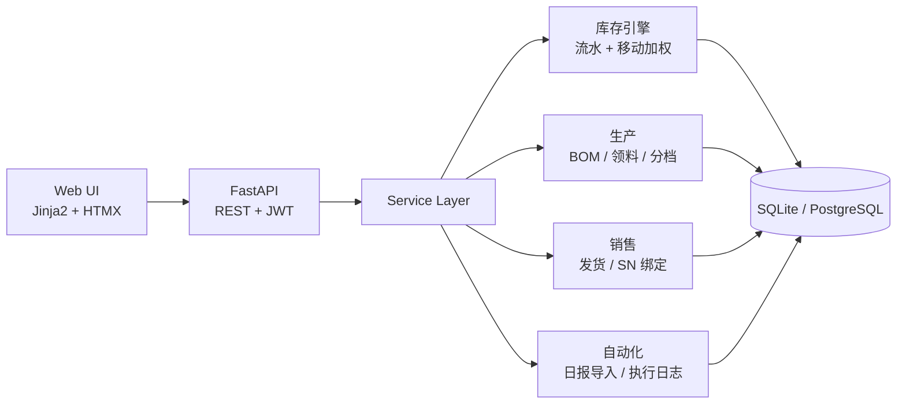
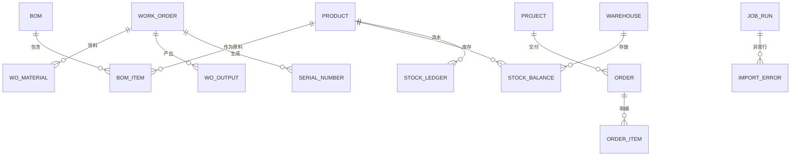

# 光伏组件制造 · 轻量 MES + 进销存 Demo


> 面向「光伏组件 + 工商业分布式」场景的可运行示例：**采购 → BOM 领料 → 功率分档完工 → 序列号追溯 → 项目发货 → 项目毛利**，并内置**生产日报自动导入**（RPA 场景）。

这个项目不是通用进销存模板，而是把光伏制造的两个行业特征做进了数据模型和成本逻辑：

1. **组件按功率分档**：同一张工单产出的 545W / 550W / 555W 组件是不同 SKU，成本按瓦数比例分摊；
2. **序列号一物一码**：SN 在车间生成、随发货绑定到具体项目，质保期从出库起算。

---

## 一、业务背景

一家做光伏组件和工商业储能系统的制造商，典型业务链是：

```
电池片/玻璃/EVA/边框 采购入库
        ↓
   工单领料（按 BOM 展开，含损耗率）
        ↓
   组件生产 → 按实测功率分档 → 生成 SN → 成品入库
        ↓
   工商业分布式项目订单 → 分批发货 → 现场签收 → 质保激活
```

行业里最容易被通用进销存做错的四件事：

| 行业特征 | 通用进销存的坑 | 本项目做法 |
|---|---|---|
| 组件按「块」卖、按「W」计价 | 单一计量单位，金额对不上 | 数量 + 单件功率两个维度，金额 = 数量 × 功率 × 元/W |
| 同一工单产出多个功率档 | 一个成品一个成本，毛利失真 | 分档 SKU + 按瓦数比例分摊工单成本 |
| 每块组件唯一 SN，25 年质保 | 只记批次，售后查不到去向 | SN 从完工生成，发货绑定项目，记录质保起止 |
| 项目制交付、分批发货 | 按客户锁库存，项目间串货 | 销售单挂项目号，按项目归集收入、成本、毛利 |

---

## 二、功能一览

**基础资料**：物料（原料 / 成品 / 功率档 SKU）、BOM、客户、供应商、仓库（原料仓 / 成品仓 / 项目现场仓）、项目

**采购**：采购单 `草稿 → 审核 → 收货`，收货写入库存流水与批次

**生产**：工单 `草稿 → 下达 → 领料 → 完工`
- 领料按 BOM 展开，自动计算损耗率，归集材料成本
- 完工按功率档录入产出，批量生成 SN，成本按「数量 × 功率」分摊

**销售**：销售单（挂项目）`草稿 → 审核 → 发货`
- 发货扣减库存、绑定 SN、按移动加权平均结转成本
- 项目毛利 = 项目收入 − 项目出库成本

**库存**：实时余额、库存流水、序列号查询

**报表**：项目毛利、工单成本、库存汇总

**自动化**：生产日报 CSV 导入 → 自动完工 + 生成 SN → 执行日志 + 异常行报告

---

## 三、关键设计

### 1. 库存流水是唯一真相

所有库存变动只能通过 `stock_in` / `stock_out` 写入 `stock_ledger`，`stock_balances` 只是加速查询的余额表。

- 禁止直接改库存数字，盘点差异也要走调整单（Roadmap）；
- 批次只做追溯，不参与计价；
- 出库成本使用**移动加权平均**：`单位成本 = 当前库存金额 / 当前库存数量`。

### 2. 工单状态机

```
DRAFT ──下达──> RELEASED ──领料──> ISSUED ──完工──> COMPLETED
```

- 只有 `ISSUED` 状态可以完工，从状态层面保证「一张工单只完工一次」；
- 领料、完工都在同一个数据库事务里，失败整体回滚。

### 3. 功率分档的成本分摊

工单总成本：

```
总成本 = 材料成本（领料金额）+ 人工成本 + 制造费用
```

按瓦数比例分摊到各功率档：

```
某档分摊成本 = 总成本 × (该档数量 × 单件功率) / Σ(各档数量 × 单件功率)
```

尾差挂到最后一行，保证 `Σ 分摊金额 = 工单总成本`。

以 1000 块组件、总成本 279,858.72 元为例：

| 功率档 | 数量 | 总瓦数 | 分摊金额 | 单位成本 | 每瓦成本 |
|---|---:|---:|---:|---:|---:|
| 545W | 300 | 163,500 W | 83,194.36 | 277.31 | 0.5088 |
| 550W | 400 | 220,000 W | 111,943.48 | 279.86 | 0.5088 |
| 555W | 300 | 166,500 W | 84,720.88 | 282.40 | 0.5088 |

> 每瓦成本一致，正是「按瓦分摊」的验证点。

### 4. 序列号生命周期

```
完工生成（SN-{工单号}-{序号}） → IN_STOCK → SHIPPED（绑定项目 / 销售单）
```

- 发货前校验可用 SN 数量，不足直接拒绝；
- 质保起止日期在出库时写入；
- 售后可以按 SN 反查「卖给了哪个项目、哪张单」。

### 5. 自动化导入的幂等与异常处理

```
上传 CSV → 解析 → 逐行校验 → 按工单分组 → 完工入库 → 执行日志 + 异常行报告
```

- 校验项：工单存在、状态为已领料、SKU 属于成品、数量 > 0、同工单同 SKU 不重复；
- **同一工单存在错误行时整单跳过**，避免「半张工单」入库；
- 工单完工后状态变为 `COMPLETED`，重复导入会直接报错，天然幂等；
- 每个错误行记录行号、原始数据、失败原因，可修正后重新导入；
- 整个任务写入 `job_runs`，包含成功 / 失败行数与耗时。

---

## 四、架构



分层：`routers`（HTTP）→ `services`（业务规则）→ `models`（持久化）。库存、成本、SN 的规则全部在 service 层，API 和 Web 共用同一套逻辑。

### 数据模型（核心关系）



完整表结构见 [`app/models.py`](app/models.py)，共 17 张表。

---

## 五、和 RPA 的对应关系

这个 Demo 的机制可以一一映射到 RPA 平台概念——面试时可以顺着这张表讲：

| 本项目 | RPA 概念 |
|---|---|
| CSV 上传 / 定时触发 | 触发器（Trigger） |
| 工单状态机 | 流程编排（Workflow） |
| `job_runs` | 机器人执行日志 |
| `import_errors` 异常行 + 修正重导 | 异常处理、人工接管（Human-in-the-loop） |
| 工单只能完工一次 | 幂等执行 |
| REST API / 文件导入 | 系统集成 |
| 角色 + 数据归属 | 控制台资源与权限 |

生产日报导入是最典型的 RPA 场景：**车间数据在 Excel 里，业务系统只认接口或表单**，机器人负责搬运、校验、回写、留痕。

---

## 六、快速开始

### 方式一：本地运行

```bash
python -m venv .venv

# Windows
.venv\Scripts\activate
# macOS / Linux
source .venv/bin/activate

pip install -r requirements.txt
python -m app.seed
uvicorn app.main:app --reload --port 8000
```

打开 http://127.0.0.1:8000 ，Swagger 文档在 http://127.0.0.1:8000/docs 。

### 方式二：Docker

```bash
docker compose up --build
```

打开 http://127.0.0.1:8000 。数据持久化在 `./data/psi.db`。

### 演示账号

| 账号 | 密码 | 角色 |
|---|---|---|
| `admin` | `admin123` | 管理员 |
| `sales` | `sales123` | 销售 |
| `prod` | `prod123` | 生产 |
| `wh` | `wh123` | 仓管 |

> 密码使用 PBKDF2-HMAC-SHA256 加盐存储；JWT 放在 HttpOnly Cookie 中，API 同时支持 `Authorization: Bearer`。

---

## 七、5 分钟演示脚本

种子数据已经准备好一条完整的演示链路：

1. **登录** `admin / admin123`，概览页看到库存金额、在制工单。
2. **生产**：进入工单 `WO...-0001`（1000 块，状态 `ISSUED`），填写产出：
   ```
   MOD-545,300
   MOD-550,400
   MOD-555,300
   ```
   人工成本 `12000`、制造费用 `8000` → 完工。
   观察：三个功率档分别入库、成本按瓦分摊、生成 1000 个 SN。
3. **销售**：进入销售单 `SO...-0002`（草稿，挂 PRJ-2026-001）→ 审核 → 发货。
   观察：库存扣减、SN 状态变为 `SHIPPED`、出库成本结转。
4. **报表**：项目毛利出现 `PRJ-2026-001` 的收入、成本、毛利率。
5. **自动化**：进入「自动化」，上传 `samples/production_report.csv`（种子数据自动生成），
   观察：另一张工单 `WO...-0002` 被自动完工、执行日志显示成功行数、重复上传会报错。
6. **/docs**：展示 REST API 与 OpenAPI 文档。

---

## 八、API 一览

完整交互式文档：`/docs`

| 分组 | 接口 |
|---|---|
| 认证 | `POST /api/auth/login`、`GET /api/auth/me` |
| 基础资料 | `/api/products`、`/api/partners`、`/api/warehouses`、`/api/projects`、`/api/boms` |
| 采购 | `GET/POST /api/purchase-orders`、`/{id}/approve`、`/{id}/receive` |
| 生产 | `GET/POST /api/work-orders`、`/{id}/release`、`/{id}/issue`、`/{id}/complete` |
| 销售 | `GET/POST /api/sales-orders`、`/{id}/approve`、`/{id}/ship` |
| 库存 | `GET /api/stock/balances`、`/api/stock/ledger`、`/api/serials` |
| 报表 | `GET /api/reports/stock-summary`、`/project-margin`、`/wo-cost`、`/api/dashboard` |
| 自动化 | `POST /api/automation/production-report`、`GET /api/automation/jobs`、`/template` |

所有写接口都需要登录；核心写操作做了角色校验（管理员 / 销售 / 生产 / 仓管）。

---

## 九、测试

```bash
pytest
```

覆盖 9 个用例：

- 移动加权平均出库成本
- 工单领料 + 功率分档成本分摊 + 分摊总额守恒
- 销售发货绑定序列号、库存扣减
- 自动化导入成功 + 重复导入失败（幂等）
- 登录、页面渲染、API 鉴权、BOM / 库存查询

---

## 十、项目结构

```
.
├── app/
│   ├── main.py              # FastAPI 入口、异常处理、静态资源
│   ├── config.py            # 配置（环境变量）
│   ├── db.py                # Engine / Session / Base
│   ├── models.py            # 17 张表的领域模型
│   ├── schemas.py           # Pydantic 入参
│   ├── security.py          # PBKDF2 密码、JWT、角色校验
│   ├── seed.py              # 演示数据（含样例 CSV 生成）
│   ├── services/
│   │   ├── inventory.py     # 库存流水 + 移动加权
│   │   ├── procurement.py   # 采购审核 / 收货
│   │   ├── production.py    # 工单 / 领料 / 分档完工
│   │   ├── sales.py         # 销售发货 / SN 绑定
│   │   ├── reports.py       # 库存、工单、项目毛利
│   │   ├── automation.py    # 生产日报导入
│   │   └── numbering.py     # 单号生成
│   ├── routers/
│   │   ├── api.py           # REST API
│   │   └── web.py           # 服务端渲染页面
│   ├── templates/           # Jinja2 模板
│   └── static/app.css
├── tests/                   # pytest
├── samples/                 # seed 生成的生产日报样例（git 忽略）
├── Dockerfile
├── docker-compose.yml
├── requirements.txt
└── README.md
```

---

## 十一、设计取舍与 Roadmap

**当前取舍**

- 单层 BOM、不做 MRP 与排产：一天能跑通的演示版，复杂度留在数据模型和文档里；
- SQLite 默认存储，可切 PostgreSQL（`DATABASE_URL`）；
- 单号生成是演示级实现，生产应使用独立序列表 + 行锁；
- 成本法固定为移动加权平均，未做策略切换（避免双轨导致毛利口径混乱）。

**Roadmap**

- 多层 BOM、替代料、MRP 齐套检查
- 质检（IQC / OQC）与不良品处理
- 销售退货、采购退货、返工工单
- 应收应付、收付款核销、账龄
- 外币与汇率、出口报关字段
- 审批流（超价 / 超折 / 付款）
- APScheduler 定时任务 + 机器人操作旧系统（Playwright）演示

---

## License

MIT
